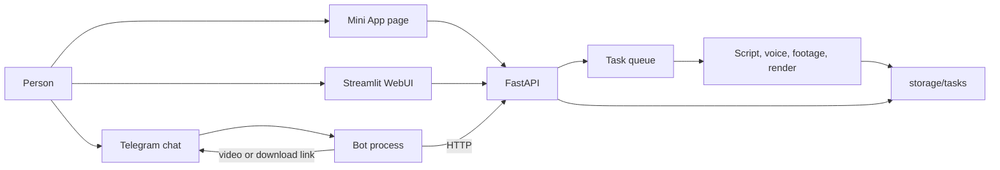
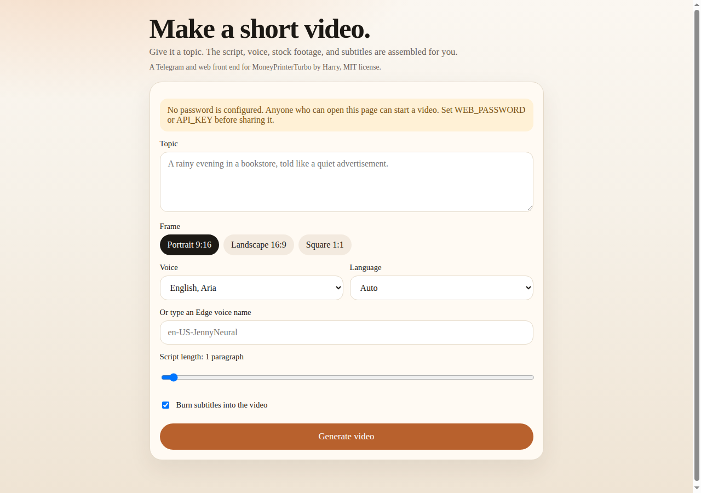
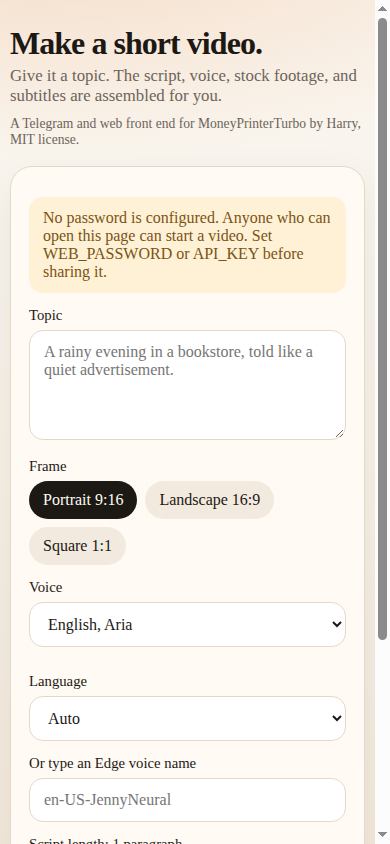

# MoneyPrinterTurbo — Telegram, Mini App, and web

This is a fork of [MoneyPrinterTurbo](https://github.com/harry0703/MoneyPrinterTurbo) by Harry (MIT). Upstream commit `90f77011d7e3b46d382e6d0180dabfb6725ffee4`. The original license is unchanged in `LICENSE`.

You give the app a topic. It asks a language model for a script and search terms, downloads stock footage, synthesizes a voiceover, builds subtitles, and renders a short video with MoviePy and FFmpeg. You can start that job from:

- a Telegram chat
- a Telegram Mini App
- the original Streamlit studio
- the same Mini App page in a normal browser

The Chinese upstream README is kept at `docs/upstream-README.zh.md`. The English upstream README is `README-en.md`.

## How the pieces fit



The API process owns the queue and the render pipeline. The bot is a separate process so a long render does not block Telegram from answering `/help`. In webhook mode the API receives Telegram updates itself, and the bot process stays idle instead of polling.

The Mini App is a page at `/miniapp`. Telegram signs the page launch with `initData`. The API checks that signature with the bot token. A normal browser can use the same page with a shared password or the API key.





## Quick start

Requirements: Python 3.11+, FFmpeg, and ImageMagick if you want that binary on the path. Docker supplies both.

```bash
python3 -m venv .venv
source .venv/bin/activate
pip install -r requirements.txt
cp config.example.toml config.toml
cp .env.example .env
```

Edit `.env` or `config.toml`. Environment variables override the TOML file. Neither file should be committed.

```bash
# API, docs at http://127.0.0.1:8080/docs , Mini App at /miniapp
python main.py

# Streamlit studio
streamlit run ./webui/Main.py --server.port 8501

# Telegram bot, long polling
python -m app.telegram
```

With no keys, the API and both web pages still start. Generating a real video needs a language-model key and a stock-footage key. Edge TTS does not need a key, but it does need network access to Microsoft.

## Docker

```bash
cp config.example.toml config.toml
cp .env.example .env
docker compose up --build
```

Copy `config.toml` before the first start. If the file is missing, Docker mounts a directory in its place and the API cannot read it.

| Service | URL on the host |
| --- | --- |
| API and Mini App | http://127.0.0.1:8080 and http://127.0.0.1:8080/miniapp |
| Streamlit | http://127.0.0.1:8501 |
| Bot | no port; it polls Telegram, or the API serves the webhook |

The image installs FFmpeg, ImageMagick, and DejaVu fonts. Ports are bound to `127.0.0.1`. Use a tunnel when Telegram needs a public HTTPS URL.

## Create the bot with BotFather

1. In Telegram, open [@BotFather](https://t.me/BotFather).
2. Send `/newbot`, then a display name and a username that ends in `bot`.
3. Copy the token into `TELEGRAM_BOT_TOKEN`.
4. Optional: `/setdescription` and `/setuserpic`.
5. Start the bot process, then send `/start` to your bot.

Useful commands:

| Command | What it does |
| --- | --- |
| `/start` | Introduces the bot and shows the Mini App button when a public URL is set |
| `/help` | Explains the steps |
| `/new` | Asks for a new topic |
| `/settings` | Shows frame, voice, length, language, and subtitles |
| `/status` | Reports the latest video |

Send a topic as a normal message, adjust the buttons, and press Generate. The bot edits a progress message and then uploads the MP4. If the file is over the upload limit (about 49 MB), it sends a signed download link instead.

To limit who can use the bot, set `TELEGRAM_ALLOWED_USER_IDS` to a comma-separated list of numeric ids. An empty list allows every account. `TELEGRAM_RATE_LIMIT_PER_HOUR` defaults to 5. Set it to `0` to disable the limit.

## Register the Mini App

Telegram only opens a Mini App from a public **HTTPS** URL.

1. Expose the API. For a quick tunnel:

   ```bash
   cloudflared tunnel --url http://127.0.0.1:8080
   ```

   ngrok works the same way: `ngrok http 8080`.

2. Put the `https://…` origin in `PUBLIC_BASE_URL` with no path and no trailing slash.
3. Restart the API and the bot. They call `setChatMenuButton` so Telegram shows a **Create** button.
4. In BotFather you can also send `/newapp` or `/setmenubutton` and use `https://YOUR_HOST/miniapp` if you want the button managed there.
5. Open the bot and press Create. The page reads `initData` and the API checks the HMAC with the bot token.

Webhook mode uses the same public host:

```env
TELEGRAM_MODE=webhook
TELEGRAM_WEBHOOK_URL=https://YOUR_HOST/telegram/webhook
TELEGRAM_WEBHOOK_SECRET=choose-a-long-random-string
```

Restart the API. It registers the webhook. The bot container stays up but does not poll. Leave `webhook_on_api = true` unless you want the bot process to listen on its own port (`8081` by default).

In a normal browser, open `/miniapp`. If `WEB_PASSWORD` or `API_KEY` is set, the page asks for it. If neither is set and there is no bot token, the page is open. Do not expose that mode on the public internet.

## Configuration

Secrets belong in `.env` or `config.toml`. See `.env.example` and the `[telegram]` section of `config.example.toml`.

| Variable | Used for |
| --- | --- |
| `TELEGRAM_BOT_TOKEN` | Bot API and Mini App signature checks |
| `PUBLIC_BASE_URL` | Mini App button and download links |
| `WEB_PASSWORD` | Browser access to the Mini App |
| `API_KEY` | `x-api-key` on `/api/v1` and `/tasks` |
| `LLM_PROVIDER` plus the matching `*_API_KEY` | Script and search terms |
| `PEXELS_API_KEYS` or `PIXABAY_API_KEYS` | Stock footage |
| `VIDEO_SOURCE` | `pexels` by default |
| `TELEGRAM_ALLOWED_USER_IDS` | Optional allowlist |
| `FFMPEG_PATH`, `IMAGEMAGICK_PATH` | Only when they are not on `PATH` |
| `TASK_RETENTION_HOURS` | Delete finished task folders. `0` keeps them |

The example config's language-model provider is `moonshot`. Set `LLM_PROVIDER` to the provider whose key you have, such as `openai`.

Finished videos older than `task_retention_hours` are deleted on a schedule. Tasks that are still rendering are kept. Pexels and Pixabay searches retry connection errors and HTTP 429/5xx. Set `MPT_HTTP_RETRY_BACKOFF` to change the delay. The default is 0.25 seconds.

## Tests

```bash
pytest test/services/test_telegram_flow.py test/services/test_reliability.py \
  test/services/test_miniapp_api.py test/services/test_compose_config.py
```

The Mini App tests replace the render pipeline with a fake, so they do not call a paid API. A full render still needs your own keys and network access to the providers you select.
