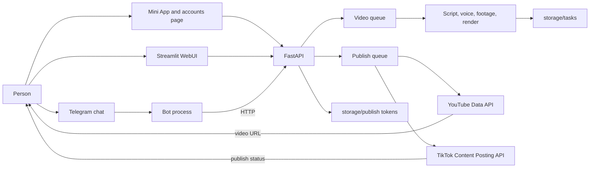
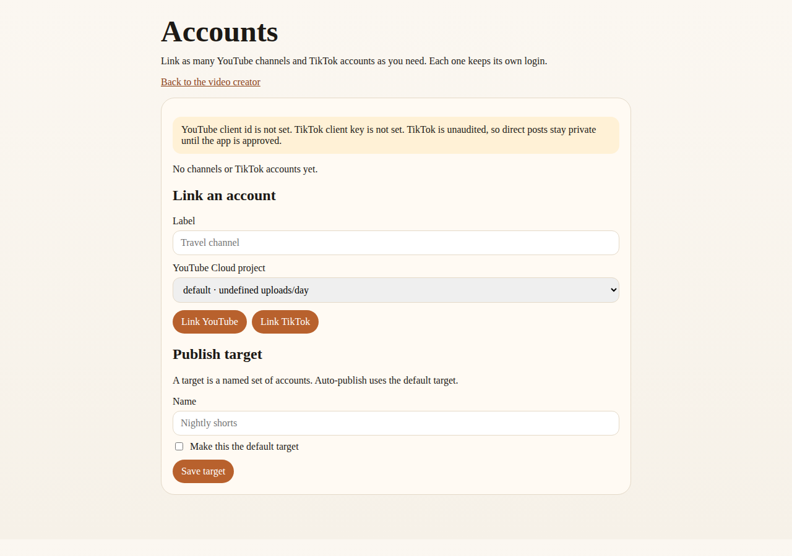
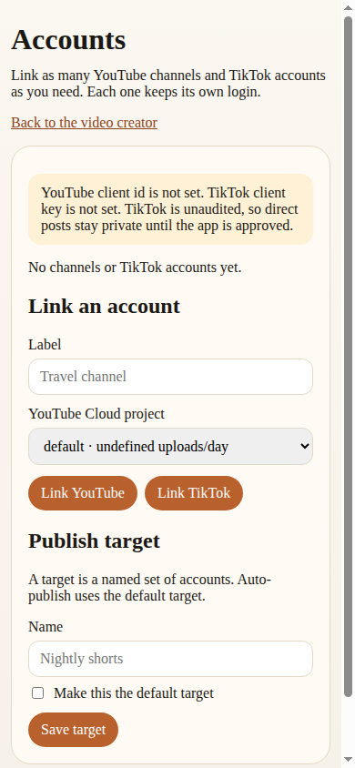

# MoneyPrinterTurbo — Telegram, Mini App, and web

This is a fork of [MoneyPrinterTurbo](https://github.com/harry0703/MoneyPrinterTurbo) by Harry (MIT). Upstream commit `90f77011d7e3b46d382e6d0180dabfb6725ffee4`. The original license is unchanged in `LICENSE`.

You give the app a topic. It asks a language model for a script and search terms, downloads stock footage, synthesizes a voiceover, builds subtitles, and renders a short video with MoviePy and FFmpeg. You can start that job from:

- a Telegram chat
- a Telegram Mini App
- the original Streamlit studio
- the same Mini App page in a normal browser

The Chinese upstream README is kept at `docs/upstream-README.zh.md`. The English upstream README is `README-en.md`.

## How the pieces fit



The API process owns the video queue and a separate publish queue. The bot is its own process so a long render does not block Telegram from answering `/help`. In webhook mode the API receives Telegram updates itself, and the bot process stays idle instead of polling.

The Mini App is a page at `/miniapp`. Telegram signs the page launch with `initData`. The API checks that signature with the bot token. A normal browser can use the same page with a shared password or the API key. Linked channels live at `/accounts`.


## Quick start

Requirements: Python 3.11+, FFmpeg, and ImageMagick if you want that binary on the path. Docker supplies both.

```bash
python3 -m venv .venv
source .venv/bin/activate
pip install -r requirements.txt
cp config.example.toml config.toml
cp .env.example .env
```

Edit `.env` or `config.toml`. Environment variables override the TOML file. Neither file should be committed.

```bash
# API, docs at http://127.0.0.1:8080/docs , Mini App at /miniapp
python main.py

# Streamlit studio
streamlit run ./webui/Main.py --server.port 8501

# Telegram bot, long polling
python -m app.telegram
```

With no keys, the API and both web pages still start. Generating a real video needs a language-model key and a stock-footage key. Edge TTS does not need a key, but it does need network access to Microsoft.

## Docker

```bash
cp config.example.toml config.toml
cp .env.example .env
docker compose up --build
```

Copy `config.toml` before the first start. If the file is missing, Docker mounts a directory in its place and the API cannot read it.

| Service | URL on the host |
| --- | --- |
| API and Mini App | http://127.0.0.1:8080 and http://127.0.0.1:8080/miniapp |
| Streamlit | http://127.0.0.1:8501 |
| Bot | no port; it polls Telegram, or the API serves the webhook |

The image installs FFmpeg, ImageMagick, and DejaVu fonts. Ports are bound to `127.0.0.1`. Use a tunnel when Telegram needs a public HTTPS URL.

## Create the bot with BotFather

1. In Telegram, open [@BotFather](https://t.me/BotFather).
2. Send `/newbot`, then a display name and a username that ends in `bot`.
3. Copy the token into `TELEGRAM_BOT_TOKEN`.
4. Optional: `/setdescription` and `/setuserpic`.
5. Start the bot process, then send `/start` to your bot.

Useful commands:

| Command | What it does |
| --- | --- |
| `/start` | Introduces the bot and shows the Mini App button when a public URL is set |
| `/help` | Explains the steps |
| `/new` | Asks for a new topic |
| `/settings` | Shows frame, voice, length, language, and subtitles |
| `/status` | Reports the latest video |
| `/accounts` | Lists linked channels, and links, renames, or unlinks them |

Send a topic as a normal message, adjust the buttons, and press Generate. The bot edits a progress message and then uploads the MP4. If the file is over the upload limit (about 49 MB), it sends a signed download link instead. Under the video it offers **Upload to YouTube**, **Upload to TikTok**, **All accounts**, and **Default target**.

To limit who can use the bot, set `TELEGRAM_ALLOWED_USER_IDS` to a comma-separated list of numeric ids. An empty list allows every account. `TELEGRAM_RATE_LIMIT_PER_HOUR` defaults to 5. Set it to `0` to disable the limit.

## Publish to YouTube and TikTok

After a video finishes, you can post it to one channel, several, or every linked account. Each account is a separate job, so one failure does not hide the others. The bot, the Mini App, and `POST /api/v1/publish` all use that queue. A job retries transient network errors, then reports a YouTube URL or a TikTok status back to the person who asked.

Refresh tokens stay in `storage/publish/accounts.json` (file mode `0600`). The API never returns them. Repeat the link flow for every channel. Give each one a label, rename it later, unlink it, or re-authorize it when Google or TikTok expires the token.

A **publish target** is a named group, such as "Nightly shorts". Mark one target as the default. Auto-publish, in the bot or the "after it finishes" checkbox on the Mini App, sends the video to that group. `PUBLISH_STAGGER_SECONDS` (default 20) delays the start of each account's job so the posts are not a single burst. `PUBLISH_VARY_COPY=true`, or the "different caption" control, asks the language model for a distinct title and description per account.





### YouTube

1. In [Google Cloud Console](https://console.cloud.google.com/), create a project and enable **YouTube Data API v3**.
2. Open **APIs & Services → OAuth consent screen**. Choose External. Add the scopes `youtube.upload` and `youtube.readonly` (`https://www.googleapis.com/auth/youtube.upload` and `https://www.googleapis.com/auth/youtube.readonly`).
3. While the app is in **Testing**, add every Google account that will upload as a test user. Testing refresh tokens stop working after 7 days. To keep them, publish the consent screen and complete Google's verification. `youtube.upload` is a sensitive scope, so verification asks for a demo of the upload.
4. Create an **OAuth client ID** of type **Web application**.
5. Add this authorized redirect URI, with your real HTTPS origin and no trailing slash on the origin:

   `https://YOUR_HOST/auth/youtube/callback`

6. Put the client id and secret in `.env`:

   ```env
   YOUTUBE_CLIENT_ID=...
   YOUTUBE_CLIENT_SECRET=...
   PUBLIC_BASE_URL=https://YOUR_HOST
   ```

7. Restart the API. Open `/accounts` (or `/accounts` from the bot's link) and press **Link YouTube**. Sign in with the channel's Google account. Repeat for the next channel.

`videos.insert` costs 1,600 quota units. A new Cloud project has 10,000 units per day, which is about **6 uploads**. The app stops at `YOUTUBE_DAILY_UPLOAD_QUOTA` (default 6) and tells you when that cap is hit. To upload more:

- In Cloud Console open **APIs & Services → YouTube Data API v3 → Quotas** and request a higher quota, then raise `daily_upload_quota` for that project.
- Or create another Cloud project, enable the API, make another OAuth client, and add it. In `.env`:

  ```env
  YOUTUBE_PROJECTS=studio-b
  YOUTUBE_STUDIO_B_CLIENT_ID=...
  YOUTUBE_STUDIO_B_CLIENT_SECRET=...
  YOUTUBE_STUDIO_B_DAILY_UPLOAD_QUOTA=6
  ```

  When you link a channel, pick that project. A refresh token only works with the client that issued it, so a channel linked under `default` cannot borrow `studio-b`'s quota. With Docker, put extra projects in `config.toml` under `[[publish.youtube_projects]]`. The compose file forwards the default client; the config file is mounted into the container.

Vertical videos are uploaded as Shorts: the title or description includes `#Shorts`, and the link is `https://www.youtube.com/shorts/VIDEO_ID`. Privacy is public, unlisted, or private. The upload declares "not made for kids".

### TikTok

This uses TikTok's official Login Kit and Content Posting API. It does not scrape the web upload form.

1. At [developers.tiktok.com](https://developers.tiktok.com/), create an app.
2. Add **Login Kit** and **Content Posting API**.
3. Request the scopes `user.info.basic`, `video.publish`, and `video.upload`.
4. Set the redirect URI to `https://YOUR_HOST/auth/tiktok/callback`. Complete the URL verification TikTok shows for that host (the prefix file or DNS record they give you). The host must be the `PUBLIC_BASE_URL` origin.
5. Put the client key and secret in `.env` as `TIKTOK_CLIENT_KEY` and `TIKTOK_CLIENT_SECRET`. Restart, then press **Link TikTok** once per account.

`TIKTOK_POST_MODE=direct` posts immediately. `inbox` uploads a draft and TikTok notifies the phone so a person can finish it in the app.

**Unaudited apps can only direct-post as private (`SELF_ONLY`).** Leave `TIKTOK_AUDITED` unset until TikTok approves the app. A public direct post is rejected with an explanation instead of being sent. Inbox drafts are still available. To apply: in the developer portal open the app, submit the Content Posting API audit, and include the website URL, a privacy-policy URL, and a short screen recording of this integration. After approval set `TIKTOK_AUDITED=true`. Public then maps to `PUBLIC_TO_EVERYONE`. TikTok has no unlisted state, so "unlisted" is sent as a private post.

TikTok also rate-limits each user and each app, and answers with `rate_limit_exceeded` when a burst is too fast. This server spaces jobs with `PUBLISH_STAGGER_SECONDS` and stops an account after `TIKTOK_DAILY_POSTS_PER_ACCOUNT` successful starts per UTC day. That number defaults to **15 and is a local guard**, not a quota TikTok publishes. Set it to the limit you see on your app, and keep the stagger above zero when many accounts post the same video.

### Publish API

| Method | Path | Purpose |
| --- | --- | --- |
| GET | `/api/v1/publish/setup` | Accounts, targets, quota, and whether keys are set |
| POST | `/api/v1/publish/connect` | One-time URL that starts OAuth |
| POST | `/api/v1/publish/accounts/{id}` | Rename. Body: `{"label": "Travel"}` |
| DELETE | `/api/v1/publish/accounts/{id}` | Unlink and delete the refresh token |
| POST | `/api/v1/publish/targets` | Create a named group. `is_default` marks it for auto-publish |
| POST | `/api/v1/publish/metadata` | Draft title, description, and hashtags for a finished task |
| POST | `/api/v1/publish` | Queue one job per account. Body includes `account_ids` or `target_id` or `"all": true` |
| GET | `/api/v1/publish/jobs/{id}` | One account's status, YouTube URL, or error |
| GET | `/api/v1/publish/tasks/{task_id}` | Every job for that video |

The same password, API key, or Telegram `initData` used by the Mini App protects these routes. Browser sign-in for OAuth uses a short-lived connect link so the Google redirect does not need a custom header.

## Register the Mini App

Telegram only opens a Mini App from a public **HTTPS** URL.

1. Expose the API. For a quick tunnel:

   ```bash
   cloudflared tunnel --url http://127.0.0.1:8080
   ```

   ngrok works the same way: `ngrok http 8080`.

2. Put the `https://…` origin in `PUBLIC_BASE_URL` with no path and no trailing slash.
3. Restart the API and the bot. They call `setChatMenuButton` so Telegram shows a **Create** button.
4. In BotFather you can also send `/newapp` or `/setmenubutton` and use `https://YOUR_HOST/miniapp` if you want the button managed there.
5. Open the bot and press Create. The page reads `initData` and the API checks the HMAC with the bot token.

Webhook mode uses the same public host:

```env
TELEGRAM_MODE=webhook
TELEGRAM_WEBHOOK_URL=https://YOUR_HOST/telegram/webhook
TELEGRAM_WEBHOOK_SECRET=choose-a-long-random-string
```

Restart the API. It registers the webhook. The bot container stays up but does not poll. Leave `webhook_on_api = true` unless you want the bot process to listen on its own port (`8081` by default).

In a normal browser, open `/miniapp`. If `WEB_PASSWORD` or `API_KEY` is set, the page asks for it. If neither is set and there is no bot token, the page is open. Do not expose that mode on the public internet.

## Configuration

Secrets belong in `.env` or `config.toml`. See `.env.example` and the `[telegram]` section of `config.example.toml`.

| Variable | Used for |
| --- | --- |
| `TELEGRAM_BOT_TOKEN` | Bot API and Mini App signature checks |
| `PUBLIC_BASE_URL` | Mini App button and download links |
| `WEB_PASSWORD` | Browser access to the Mini App |
| `API_KEY` | `x-api-key` on `/api/v1` and `/tasks` |
| `LLM_PROVIDER` plus the matching `*_API_KEY` | Script and search terms |
| `PEXELS_API_KEYS` or `PIXABAY_API_KEYS` | Stock footage |
| `YOUTUBE_CLIENT_ID` and `YOUTUBE_CLIENT_SECRET` | YouTube OAuth client |
| `YOUTUBE_PROJECTS` plus `YOUTUBE_<SLUG>_CLIENT_ID` | Another Cloud project when the default 6 uploads per day are not enough |
| `TIKTOK_CLIENT_KEY` and `TIKTOK_CLIENT_SECRET` | TikTok Login Kit |
| `TIKTOK_AUDITED` | `true` only after TikTok approves public direct posts |
| `PUBLISH_STAGGER_SECONDS` | Delay between each account's upload |
| `VIDEO_SOURCE` | `pexels` by default |
| `TELEGRAM_ALLOWED_USER_IDS` | Optional allowlist |
| `FFMPEG_PATH`, `IMAGEMAGICK_PATH` | Only when they are not on `PATH` |
| `TASK_RETENTION_HOURS` | Delete finished task folders. `0` keeps them |

The example config's language-model provider is `moonshot`. Set `LLM_PROVIDER` to the provider whose key you have, such as `openai`.

Finished videos older than `task_retention_hours` are deleted on a schedule. Tasks that are still rendering are kept. Pexels and Pixabay searches retry connection errors and HTTP 429/5xx. Set `MPT_HTTP_RETRY_BACKOFF` to change the delay. The default is 0.25 seconds.

## Tests

```bash
pytest test/services/test_telegram_flow.py test/services/test_reliability.py \
  test/services/test_miniapp_api.py test/services/test_compose_config.py
```

The Mini App tests replace the render pipeline with a fake, so they do not call a paid API. A full render still needs your own keys and network access to the providers you select.
